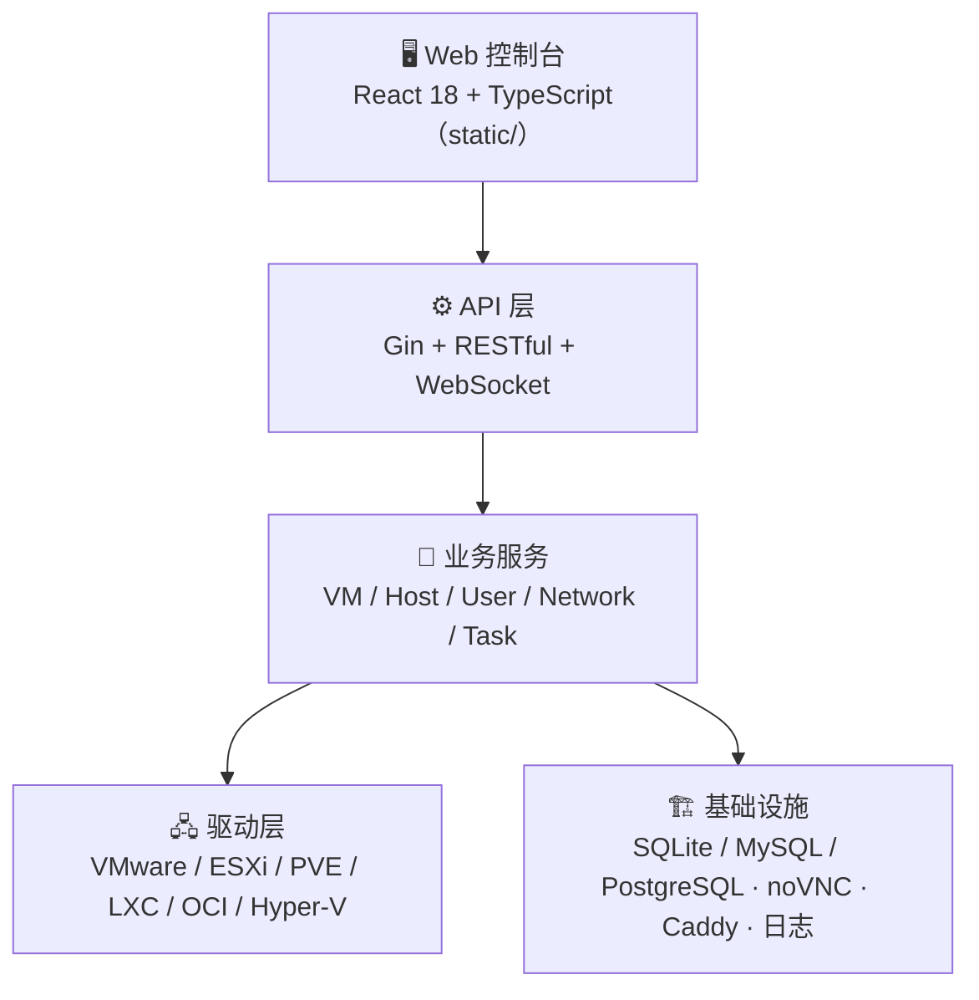

<div align="center">
  

  <h1>QuickIDC CloudHost</h1>

  <p><em>开源 IDC 虚拟化统一管理平台</em></p>
  <p>用一个 Web 控制台和一套 REST API，统一管理 VMware、Proxmox VE、LXC/LXD、Docker/OCI、Hyper-V、ESXi 等虚拟化运行时</p>

<a href="https://github.com/QuickIDC/CloudHost/stargazers"></a>
<a href="https://github.com/QuickIDC/CloudHost/network/members"></a>
<a href="https://github.com/QuickIDC/CloudHost/issues"></a>
<a href="https://github.com/QuickIDC/CloudHost/commits/main"></a>
<a href="https://github.com/QuickIDC/CloudHost/blob/main/go.mod"></a>
<a href="https://www.gnu.org/licenses/agpl-3.0.txt"></a>

📘 [使用文档](https://idcdoc.opkg.cn) · 📦 [下载发布版](https://github.com/QuickIDC/CloudHost/releases) · 🐛 [问题反馈](https://github.com/QuickIDC/CloudHost/issues) · 🧩 [前端仓库](https://github.com/QuickIDC/FrontPage)

</div>

---

## 项目简介

QuickIDC CloudHost（运行时名 `hostagent`）是一个可自托管的 IDC 虚拟化统一管理平台。它在宿主机上以单个静态二进制运行，内置 Web 控制台、RESTful API、VNC 控制台、SSH 终端、网络与 NAT 管理、任务调度等能力，把分散在多种虚拟化平台上的虚拟机收敛到一套界面和一套权限体系中。

- **单文件部署**：Go 编译，无 CGO、无 Python / Node 运行时依赖，SQLite 默认落盘
- **多平台驱动**：同一套 API 对接 VMware Workstation、vSphere ESXi、Proxmox VE、LXC/LXD、Docker/OCI、Windows Hyper-V 等
- **面向运营**：多租户、RBAC、资源配额、计费对接插件、完整操作日志
- **开箱即用**：Linux / Windows / macOS 安装包与一键脚本，安装后由 systemd / NSSM / launchd 托管

> [!IMPORTANT]
> - 首次访问 `http://<主机>:1881` 会进入初始化向导，设置系统标题与管理员密码
> - 首次启动会在控制台输出 API Token，该 Token 仅用于 API / CLI / 插件调用，Web 登录请使用账号密码
> - Web 前端资源位于程序目录的 `static/`，安装包已内置；手动部署时请保持目录结构一致
> - 升级安装会保留数据目录，卸载时加 `--purge` 才会删除数据

## 核心特性

| 模块 | 能力 |
|------|------|
| 🖥️ **虚拟机生命周期** | 创建 / 配置 / 启动 / 停止 / 重启 / 删除，实时状态监控，CPU、内存、磁盘动态调整 |
| 💾 **存储与镜像** | 虚拟磁盘挂载 / 卸载、ISO 镜像管理、磁盘检查与迁移、快照与备份还原 |
| 🌐 **网络与安全** | 智能 IP 分配、NAT 端口转发、Web 反向代理、iptables 防火墙规则、公网 IP 绑定 |
| 👥 **多租户与权限** | RBAC 角色权限、目录级细粒度控制、CPU / 内存 / 存储 / 流量资源配额 |
| 📊 **监控与运维** | 宿主机与虚拟机性能监控、资源可视化、操作日志、定时任务与异步任务队列 |
| 🔌 **远程访问** | 基于 noVNC 的 Web 控制台、浏览器内 SSH 终端，无需安装客户端 |
| 🧩 **扩展能力** | 财务面板对接插件（IDCSmart / SwapIDC / EasyPanel 等）、主机配置备份、多语言界面 |
| 🚀 **部署形态** | Linux 一键脚本、Windows Inno Setup 安装包、macOS pkg、`quickidc` CLI 与桌面客户端 |

### 适用场景

| 场景 | 说明 |
|------|------|
| 🏢 **中小企业 IT** | 统一管理开发、测试、生产环境虚拟机 |
| ☁️ **私有云运维** | 作为私有云平台的轻量级管理前端 |
| 🎓 **教育培训** | 为实验室或培训中心提供虚拟机资源共享 |
| 🔬 **研发团队** | 管理开发测试环境的虚拟机集群 |
| 🏭 **IDC 转型** | 帮助传统 IDC 服务商快速提供虚拟化服务 |

## 平台支持

| 平台 | 状态 | 受控端操作系统 | 架构 |
|------|:----:|----------------|------|
| LXC / LXD | ✅ 已实现 | Windows, Linux | x86_64, ARM64 |
| Docker / Podman / OCI | ✅ 已实现 | Windows, Linux, macOS | x86_64, ARM64 |
| VMware Workstation | ✅ 已实现 | Windows | x86_64 |
| Proxmox VE | ✅ 已实现 | Windows, Linux | x86_64, ARM64 |
| VMware vSphere / ESXi | ✅ 已实现 | Windows, Linux, macOS | x86_64, ARM64 |
| Windows Hyper-V | ✅ 已实现 | Windows | x86_64 |
| MEmu 模拟器 | ✅ 已实现 | Windows | x86_64 |
| Oracle VirtualBox | 🚧 开发中 | Windows, Linux | x86_64, ARM64 |
| QEMU / KVM | 🚧 开发中 | Windows, Linux, macOS | x86_64, ARM64 |

### 操作支持矩阵

图例：✅ 原生支持 · 🔑 依赖客户机内 CloudInit 完成 · ⚠️ 部分支持 · ❌ 不支持 · — 平台无对应概念

| 方法 | 功能 | VMware | LXC | OCI | PVE | Hyper-V | ESXi |
|------|------|:------:|:---:|:---:|:---:|:-------:|:----:|
| `VMPasswd` | 修改密码 | ✅ | 🔑 | 🔑 | ✅ | ✅ | ✅ |
| `VMScreen` | 截图 | ✅ | ❌ | ❌ | ✅ | ✅ | ✅ |
| `VMBackup` | 备份 | ✅ | ✅ | ✅ | ✅ | ✅ | ✅ |
| `Restores` | 还原 | ✅ | ✅ | ✅ | ✅ | ✅ | ✅ |
| `LDBackup` | 列出备份 | ✅ | ✅ | ✅ | ⚠️ | ✅ | ✅ |
| `RMBackup` | 删除备份 | ✅ | ✅ | ✅ | ⚠️ | ✅ | ✅ |
| `HDDMount` | 挂载磁盘 | ✅ | ✅ | ✅ | ✅ | ✅ | ✅ |
| `ISOMount` | 挂载 ISO | ✅ | ❌ | ✅ | ✅ | ✅ | ✅ |
| `RMMounts` | 卸载磁盘 | ✅ | ✅ | ✅ | ✅ | ✅ | ✅ |
| `HDDCheck` | 磁盘检查 | ✅ | ❌ | ❌ | ✅ | ❌ | ✅ |
| `HDDTrans` | 磁盘迁移 | ✅ | ❌ | ❌ | ✅ | — | — |
| `PCIShows` | 列出 PCI | ❌ | ❌ | ✅ | ✅ | ✅ | ✅ |
| `PCISetup` | 配置 PCI | ✅ | ❌ | ❌ | ✅ | ✅ | ✅ |
| `USBShows` | 列出 USB | ✅ | ❌ | ❌ | ✅ | ❌ | ✅ |
| `USBSetup` | 配置 USB | ✅ | ❌ | ❌ | ✅ | ❌ | ✅ |

## 快速开始

所有安装方式都从 [Releases](https://github.com/QuickIDC/CloudHost/releases) 获取预编译二进制，目标机无需 Go 环境。

### Linux 一键安装（推荐）

```bash
curl -fsSL https://idcgit.opkg.cn/install.sh | sudo bash
```

脚本按 CPU 架构下载对应 Release 资产，程序安装到 `/opt/quickidc`，数据写入 `/var/lib/quickidc`，并注册 systemd 服务 `quickidc`（默认端口 `1881`，开机自启）。

```bash
sudo systemctl status quickidc     # 查看状态
sudo journalctl -u quickidc -f     # 查看实时日志
sudo bash install.sh --uninstall   # 卸载（保留数据）
```

常用参数：

| 参数 | 说明 |
|------|------|
| `--version v1.0.0` | 指定 Release 版本，默认 `latest`，也支持 `alpha` / `beta` |
| `--port 1881` | HTTP 端口 |
| `--dir /opt/quickidc` | 程序安装目录 |
| `--data-dir /var/lib/quickidc` | 数据目录 |
| `--file ./hostagent-linux-amd64.tar.gz` | 使用离线包安装 |
| `--firewall` | 自动放行 1881 / 6080 / 7681 |
| `--uninstall [--purge]` | 卸载，`--purge` 同时删除数据 |

### Windows 安装（Inno Setup）

1. 从 [Releases](https://github.com/QuickIDC/CloudHost/releases) 下载 `QuickIDC-HostAgent-<版本>-win-x64-setup.exe`
2. 双击安装，安装器通过 NSSM 注册系统服务 `QuickIDC-HostAgent`（LocalSystem，开机自启，异常自动重启），可选放行 1881 / 6080 / 7681 端口

| 项目 | 路径 |
|------|------|
| 程序目录 | `C:\Program Files\QuickIDC\HostAgent` |
| 数据目录 | `C:\ProgramData\QuickIDC\HostAgent\data`（升级不丢失，含 `data.db` 与 `data.yaml`） |
| 服务名 | `QuickIDC-HostAgent` |

也可以下载 `hostagent-windows-amd64.zip` 免安装运行。

### macOS 安装（pkg）

```bash
# 构建 pkg（需 macOS + Xcode Command Line Tools）
GOOS=darwin GOARCH=arm64 CGO_ENABLED=0 \
  go build -trimpath -ldflags "-s -w" -o dist/hostagent-darwin-arm64 ./cmd/server
chmod +x packaging/macos/build-pkg.sh
./packaging/macos/build-pkg.sh 1.0.0 arm64

sudo installer -pkg BuildCache/QuickIDC-HostAgent-1.0.0-macos-arm64.pkg -target /
```

安装到 `/usr/local/quickidc`，由 launchd 服务 `com.quickidc.hostagent` 托管，数据目录为 `/usr/local/var/lib/quickidc`。CI 中的 macOS 任务默认注释，需要时在 `.github/workflows/release.yml` 取消 `build-macos` 注释。

### 首次使用

1. **初始化系统**：浏览器打开 `http://localhost:1881`，设置系统标题与管理员密码
2. **登录系统**：使用用户名 `admin` 与刚设置的密码登录
3. **添加主机**：在「主机管理」中添加 VMware、PVE、LXC 等受控主机
4. **配置网络**：设置 IP 地址池、NAT 规则与端口转发
5. **创建用户**：为团队成员创建账户并分配角色与配额
6. **开始管理**：创建并管理虚拟机

## 配置说明

| 项目 | 说明 |
|------|------|
| 数据目录 | `data/`：`bins/` 外部二进制、`logs/` 日志、`temp/` 临时文件与备份、`data.db`、`data.yaml` |
| 配置文件 | `data/data.yaml`：端口、VNC / SSH 端口、数据库驱动与连接、日志级别 |
| 数据库 | 默认 SQLite（`data/data.db`），可切换 MySQL / PostgreSQL |
| 多语言 | 前端 `FrontPage` 仓库的 `src/i18n`，后端 `internal/i18n` |
| API 认证 | 支持 Token 与 Session 双重认证 |

`data/data.yaml` 示例：

```yaml
server:
  host: 0.0.0.0
  port: 1881
  vnc_port: 6080
  ssh_port: 7681
database:
  driver: sqlite          # sqlite | mysql | postgres
  dsn: ""                 # 填了则优先于下方分段配置
  sqlite:
    file: data.db
  mysql:
    host: 127.0.0.1
    port: 3306
    user: quickidc
    password: ""
    database: quickidc
    params: charset=utf8mb4&parseTime=true&loc=Local
  postgres:
    host: 127.0.0.1
    port: 5432
    user: quickidc
    password: ""
    database: quickidc
    sslmode: disable
log:
  console: info
  file: debug
  db: info
```

- 端口优先级：命令行 `--port` > `data.yaml` > 默认 `1881`
- SQLite 之外的数据库需先建库，并授予建表 / 索引权限；首次启动自动建表
- 切换数据库不会自动搬迁旧数据，请使用 `quickidc host export` 或 SQL 工具迁移
- 旧版 `DataSaving/` 会在首次启动时自动迁移到 `data/`（数据库、日志、Caddyfile、备份、密钥），原目录保留

可选环境变量：

| 变量 | 默认值 | 说明 |
|------|--------|------|
| `QUICKIDC_PORT` | `1881` | HTTP 监听端口 |
| `QUICKIDC_DATA_DIR` | 平台默认 | 数据目录 |
| `QUICKIDC_DB_DRIVER` | `sqlite` | 数据库驱动 |
| `QUICKIDC_DB_DSN` | 空 | 数据库连接串，优先级最高 |
| `QUICKIDC_COOKIE_SECURE` | 关闭 | 设为 `1` 时会话 Cookie 仅通过 HTTPS 回传；HTTPS 部署应开启，纯 HTTP 部署必须关闭 |
| `QUICKIDC_TASK_TIMEOUT_MINUTES` | `30` | 异步任务（创建 / 删除 / 更新 / 重装虚拟机）超时时间，备份与还原固定 24 小时 |

## 技术架构



| 层级 | 组件 |
|------|------|
| 运行环境 | Linux / Windows / macOS，单一静态二进制，`CGO_ENABLED=0` |
| Web 框架 | [Gin](https://github.com/gin-gonic/gin) + gorilla/websocket |
| CLI | [Cobra](https://github.com/spf13/cobra)（`quickidc`） |
| 数据库 | SQLite（`modernc.org/sqlite`，纯 Go）/ MySQL / PostgreSQL |
| 前端 | React 18 + TypeScript + Vite + Ant Design 5 + ECharts + TailwindCSS |
| 控制台 | noVNC（`VNCConsole/`）+ xterm.js SSH 终端 |
| 打包 | systemd / NSSM（Inno Setup）/ launchd + pkgbuild |

## 项目结构

```text
CloudHost/
├── cmd/
│   ├── server/                 # hostagent 主程序入口
│   └── quickidc/               # quickidc 命令行工具
├── internal/
│   ├── api/                    # REST API 路由与处理器
│   ├── appconfig/              # data.yaml 配置加载与生成
│   ├── auth/                   # 登录、Token、会话与权限
│   ├── cidata/                 # CloudInit 元数据生成
│   ├── cli/                    # CLI 子命令
│   ├── data/                   # 数据访问层（SQLite / MySQL / PostgreSQL）
│   ├── driver/                 # 虚拟化平台驱动（VMware / ESXi / PVE / LXC / OCI / Hyper-V）
│   ├── i18n/                   # 后端多语言资源
│   ├── logger/                 # 日志
│   ├── middleware/             # 中间件（鉴权、审计、恢复等）
│   ├── model/                  # 数据模型
│   ├── paths/                  # 运行路径解析
│   ├── scheduler/              # 定时任务
│   ├── security/               # 加密与安全工具
│   ├── service/                # 业务服务层
│   └── task/                   # 异步任务队列
├── pkg/
│   ├── utils/                  # 通用工具
│   └── validator/              # 参数校验
├── plugins/                    # 财务面板对接插件（IDCSmart / SwapIDC / EasyPanel 等）
├── static/                     # 内置 Web 前端产物
├── pages/                      # 安装站点页面
├── packaging/
│   ├── windows/                # Inno Setup 安装包脚本
│   └── macos/                  # pkg 构建脚本与 launchd 配置
├── scripts/                    # quickidc 安装脚本（sh / ps1）
├── VNCConsole/                 # noVNC Web 控制台
├── tools/quickidc-gui/         # quickidc 桌面客户端（Tauri）
├── bin/                        # 打包附带的外部二进制
├── install.sh                  # Linux 一键安装脚本
├── build.sh / build.bat        # 本地构建脚本
└── go.mod / go.sum
```

## 开发与构建

### 环境要求

- **Go** 1.26 或更高版本
- **C 工具链**：不需要，SQLite 使用纯 Go 驱动，`CGO_ENABLED=0` 可直接交叉编译
- **操作系统**：Windows 10/11、Linux（Ubuntu 20.04+ / Debian 11+ / RHEL 8+）、macOS 12+
- **内存**：建议 8GB 以上（编译期）

### 从源码运行

```bash
git clone https://github.com/QuickIDC/CloudHost.git
cd CloudHost

go mod download
go build -o hostagent ./cmd/server      # Windows 使用 -o hostagent.exe
./hostagent --data-dir ./data
```

首次启动会生成 `data/data.yaml`（端口、数据库、日志级别），后续修改该文件即可，无需再传参数。

### 构建与发布

| 方式 | 命令 |
|------|------|
| 本地 Linux / macOS | `./build.sh [linux\|windows\|darwin]` |
| 本地 Windows | `build.bat [linux\|windows\|darwin]` |
| CI 发布 | 推送 `v*` tag（正式版），或推送 `main`（beta 滚动预发布） |
| Windows 安装包 | `packaging/windows/hostagent.iss`（Inno Setup 6 + NSSM） |
| macOS pkg | `packaging/macos/build-pkg.sh` |

> 交叉编译示例：
> `GOOS=linux GOARCH=arm64 CGO_ENABLED=0 go build -trimpath -ldflags "-s -w" -o hostagent ./cmd/server`

### 前端

Web 控制台源码位于 [QuickIDC/FrontPage](https://github.com/QuickIDC/FrontPage) 仓库，构建产物输出到本仓库 `static/`：

```bash
cd FrontPage
npm install
npm run build
```

## 贡献

欢迎通过 Issue、Pull Request、文档完善或测试反馈参与贡献。提交前请确保：

```bash
go vet ./...
go test ./...
```

## 开源许可

本项目采用 [GNU Affero General Public License v3.0](https://www.gnu.org/licenses/agpl-3.0.txt) 许可。使用、修改与分发请遵守 AGPL-3.0 条款。

## 联系我们

- **项目主页**：<https://github.com/QuickIDC/CloudHost>
- **问题反馈**：<https://github.com/QuickIDC/CloudHost/issues>
- **使用文档**：<https://idcdoc.opkg.cn>
- **邮箱**：<quickidc@team.org>

## 致谢

- 受控端 Web 与魔方财务对接插件的风格及部分代码基于 [xkatld/zjmf-lxd-server](https://github.com/xkatld/zjmf-lxd-server)（作者 xkatld）
- 感谢所有为 QuickIDC 提交代码、文档与反馈的贡献者

---

<div align="center">
  <strong>⭐ 如果这个项目对您有帮助，请给我们一个 Star</strong>
</div>
